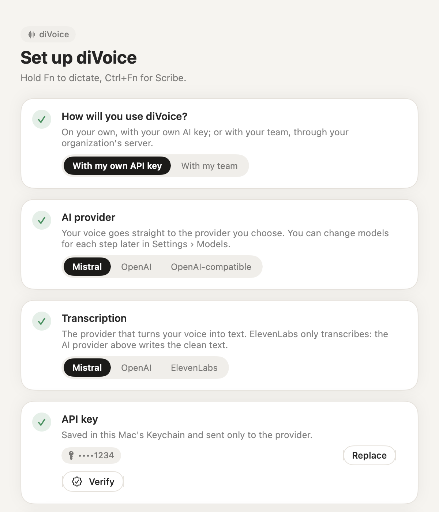
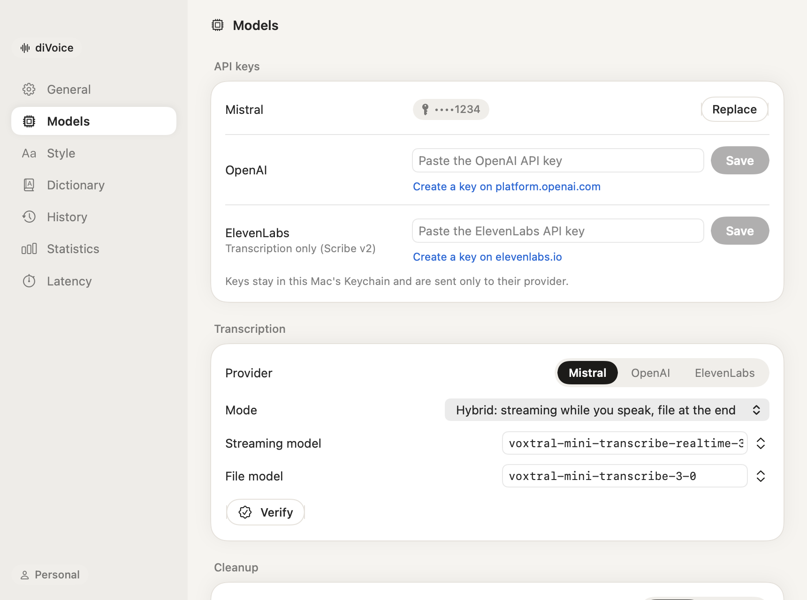
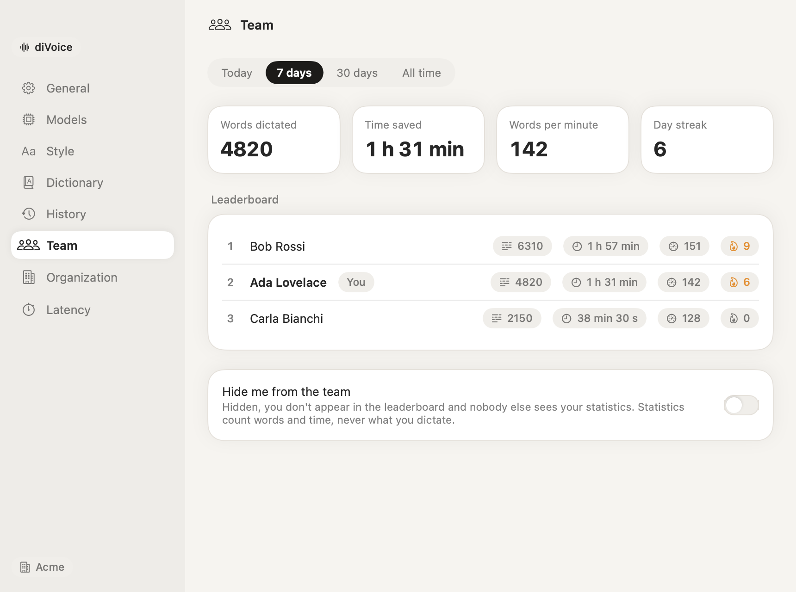
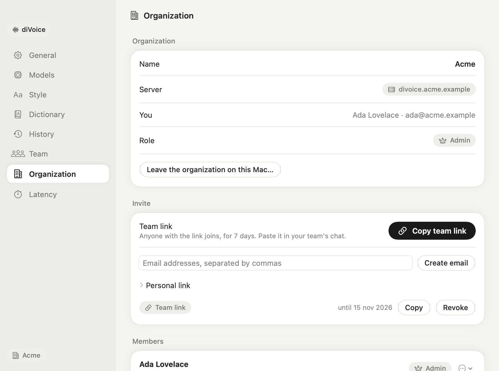

<div align="center">

# diVoice

**Voice dictation for the Mac that writes what you meant.**

Hold <kbd>Fn</kbd>, speak, release: clean text appears where you are typing, in about a second.
Pay only the AI you choose, at cost, or join your team's server.

<picture>
  <source media="(prefers-color-scheme: dark)" srcset="docs/images/overlay-recording-dark.png">
  
</picture>

[Download](https://github.com/tommasoseita/divoice/releases/latest) ·
[Getting started](docs/getting-started.md) ·
[User guide](docs/user-guide.md) ·
[For teams](docs/organizations.md) ·
[Privacy](docs/privacy.md)

</div>

---

## Why diVoice

- **Over 90% cheaper.** There's no subscription: you pay only the AI provider, at its prices. A full day of dictation costs a few cents, about a dollar a month, against the $12–15 a month of a typical dictation app ([how it adds up](docs/providers-and-models.md#cost)).
- **Made to fit you.** A tone for each kind of app, your own instructions, your dictionary, the apps and websites you use, and preferences it learns from your corrections.
- **Extend it with Claude Code.** diVoice is open source and small: open the repository in [Claude Code](https://claude.com/claude-code) and ask for the feature you want, from a new kind of app to a new shortcut, provider or workflow ([how it's built](docs/architecture.md)).
- **Your speech-to-text, your choice.** Mistral Voxtral, OpenAI or ElevenLabs Scribe v2, with a different model for each step, and you can switch at any time.

## What it does

- **Dictation that reads like writing.** Hesitations go, self-corrections are applied ("Thursday at three, actually four" becomes "Thursday at four"), punctuation and capitals are fixed, and the tone follows the app you are in: an email, a chat, a document or code. Pick the tone for each kind of app and add your own instructions.
- **Aware of the conversation.** diVoice reads the thread you're replying to and the text around the cursor, to spell names as they appear there and match the conversation's tone. Nothing of it is saved.
- **Scribe, a writer for what you say.** Hold <kbd>Ctrl</kbd>+<kbd>Fn</kbd> and diVoice rewrites your dictation as you would have written it by hand: rephrased, reordered, with lists where they help. It keeps your content, your language and your intent, and never carries out what you dictate, so a prompt you dictate for an AI stays a prompt. With text selected, say how to change it: "shorter", "more formal", "in English".
- **Your words, spelled right.** A dictionary of names, products and terms, with the ways they get misheard. It guides the transcription and fixes the text, and grows by itself when you correct a name.
- **Learns how you write.** Fix a dictated text and diVoice takes note: after a few corrections it writes the way you like in that kind of app.
- **Fast.** About one second from releasing the key to the text in your app ([measurements](docs/latency.md)).
- **Verify before you dictate.** A button for each step checks your key and model and measures the latency.
- **Built for teams.** An organization runs its own small server: it holds the AI keys and the models the admin chooses; colleagues join with a link, share a dictionary and, if they like, a leaderboard. Nobody's dictated text is ever stored.
- **Private by design.** In personal mode your voice goes straight from your Mac to the provider you chose, with your key from the macOS Keychain. Statistics count words and minutes, never what you said.

<table>
<tr>
<td></td>
<td></td>
</tr>
</table>

## Requirements

- A Mac with Apple silicon, macOS 14 Sonoma or later.
- In personal mode, an API key from [Mistral](https://console.mistral.ai/api-keys) or [OpenAI](https://platform.openai.com/api-keys); cleanup and Scribe can also run on your own OpenAI-compatible server, such as LiteLLM. With a team, nothing: your organization's server holds the keys.

## Install

1. Download `diVoice.dmg` from the [latest release](https://github.com/tommasoseita/divoice/releases/latest).
2. Open it and drag **diVoice** to **Applications**, then open it from there.
3. Follow the setup: choose **With my own API key** or **With my team**, allow the microphone and Accessibility, and set the 🌐 key to "Do Nothing".

Hold <kbd>Fn</kbd> and speak. The [getting started guide](docs/getting-started.md) walks through each step; if you were invited by your team, see [Joining a team](docs/tutorials/joining-a-team.md).

diVoice updates itself: new versions are signed, notarized by Apple and verified before they install.

<table>
<tr>
<td width="50%"></td>
<td width="50%"></td>
</tr>
<tr>
<td></td>
<td></td>
</tr>
</table>

## Documentation

| | |
|---|---|
| [Getting started](docs/getting-started.md) | Install, permissions, your first dictation |
| [User guide](docs/user-guide.md) | Dictation, Scribe, shortcuts, dictionary, statistics, settings |
| [Tutorials](docs/README.md#tutorials) | Dictating prompts for AI, building your dictionary, setting up a team, joining one |
| [Providers and models](docs/providers-and-models.md) | Mistral, OpenAI and ElevenLabs, defaults, Verify, cost and speed trade-offs |
| [Organizations](docs/organizations.md) | Admin guide: keys, models, invites, members, team dictionary, statistics |
| [Self-hosting the server](docs/self-hosting.md) | The organization server, [diServer](https://github.com/tommasoseita/diServer): what diVoice needs, and where its guides are |
| [Privacy](docs/privacy.md) | What leaves your Mac, where it goes, what is stored |
| [Troubleshooting](docs/troubleshooting.md) | Permissions, the Fn key, insertion, invites, updates |
| [Architecture](docs/architecture.md) | How the app, the engine and the server fit together |
| [Latency](docs/latency.md) | Measurements and the bench |

## How it works

```
Hold Fn ── microphone ──▶ streaming transcription (opened at the key press)
Release ──▶ final transcript ──▶ cleanup with a language model ──▶ text pasted in your app
            (Mistral: the whole recording is also transcribed at once, which is more accurate up to ~25 s)
```

In personal mode every request goes directly from your Mac to the provider. With an organization, the same requests go through the organization's server, which adds its key and the model chosen by the admin; the app builds the prompts in both cases. Details in [Architecture](docs/architecture.md).

## Build from source

You need macOS 14 and Apple's Command Line Tools; Xcode is not required.

```bash
git clone https://github.com/tommasoseita/divoice.git
cd divoice
scripts/test-app.sh          # the app's tests
scripts/build-app.sh         # build/diVoice.app, signed locally
open build/diVoice.app
```

The organization server lives in its own repository, [diServer](https://github.com/tommasoseita/diServer), shared with diMail. See [CONTRIBUTING.md](CONTRIBUTING.md) for the full setup, the bench and the release process.

## Contributing

Bug reports, ideas and pull requests are welcome: please read [CONTRIBUTING.md](CONTRIBUTING.md) and our [Code of Conduct](CODE_OF_CONDUCT.md). Security issues: see [SECURITY.md](SECURITY.md), and please don't open a public issue.

## License

diVoice is released under the [MIT License](LICENSE).
