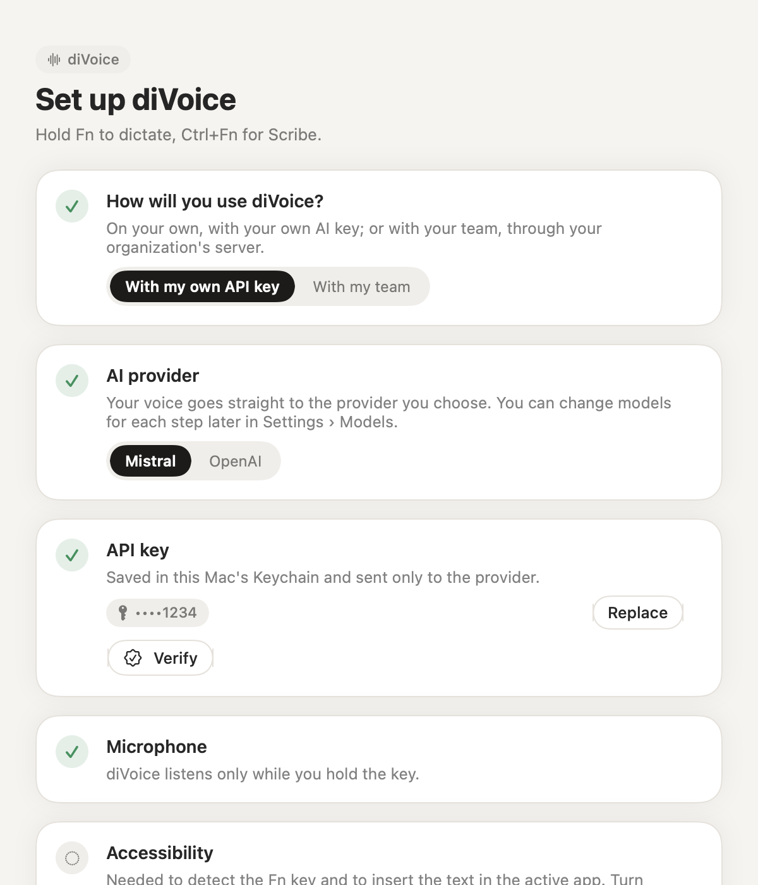

# Getting started

This guide takes you from the download to your first dictation in about five minutes.

## What you need

- A Mac with Apple silicon and macOS 14 Sonoma or later.
- One of the two:
  - **Your own API key** from [Mistral](https://console.mistral.ai/api-keys) or [OpenAI](https://platform.openai.com/api-keys). You pay the provider directly for what you use; a typical day of dictation costs cents.
  - **An invite from your team**, if your organization runs a diVoice server. You need no key: see [Joining a team](tutorials/joining-a-team.md) instead of this page.

## 1. Install

1. Download `diVoice.dmg` from the [latest release](https://github.com/tommasoseita/divoice/releases/latest).
2. Open it and drag **diVoice** onto **Applications**.
3. Open diVoice from the Applications folder. macOS asks for confirmation the first time, because the app comes from the internet: choose **Open**.

diVoice lives in the menu bar (the waveform icon), not in the Dock.

> **Run it from Applications.** If you open diVoice straight from the disk image, macOS runs a temporary copy that can't receive updates, and diVoice tells you so.

## 2. Set up

The setup window has one card per step. A green check means it's done.

1. **How will you use diVoice?** Choose **With my own API key**. (With a team, choose **With my team** and paste your invite link.)
2. **AI provider.** Mistral or OpenAI. You can change the model for each step later.
3. **API key.** Paste it and click **Save**. It is stored in your Mac's Keychain and sent only to that provider. Then click **Verify**: diVoice speaks a test sentence with the Mac's built-in voice, transcribes it and shows how long each step took.
4. **Microphone.** Click **Allow the microphone**. diVoice listens only while you hold the key.
5. **Accessibility.** Click **Open Accessibility settings** and turn diVoice on. macOS may ask for Touch ID or your password, once. diVoice needs it to notice the Fn key and to insert the text in the app you are using.
6. **🌐 / Fn key.** In **System Settings › Keyboard**, set **Press 🌐 key to** to **Do Nothing**; otherwise macOS opens the emoji picker or its own dictation together with diVoice.

Click **Start**.

## 3. Your first dictation

1. Click into any text field: a note, an email, a chat.
2. **Hold Fn**, wait for the start sound, and speak naturally, hesitations included.
3. **Release Fn.** About a second later the clean text appears where the cursor is.

While you hold the key, the overlay at the bottom of the screen shows a waveform with an orange dot. You can drag it anywhere; diVoice remembers where you put it.

## 4. Try Scribe

Hold **Ctrl+Fn** instead of Fn, and say something muddled, for example:

> "so, um, for the call on Monday I wanted to, first of all no wait, the most important thing is the budget, then the hiring, and also the launch date"

Scribe rewrites it so it reads clearly: in order, concise, with a list if it helps. It keeps your words and your intent and never acts on them. With text selected, hold Ctrl+Fn and say how to change it: "make it shorter", "more formal", "translate it into English".

## Next steps

- Add the names and terms diVoice gets wrong: [Your first dictionary](tutorials/your-first-dictionary.md).
- Learn the shortcuts and settings: [User guide](user-guide.md).
- Using an external keyboard without Fn? Hold **right ⌘** instead; you can change it in **Settings › General**.
- Something not working? [Troubleshooting](troubleshooting.md).
