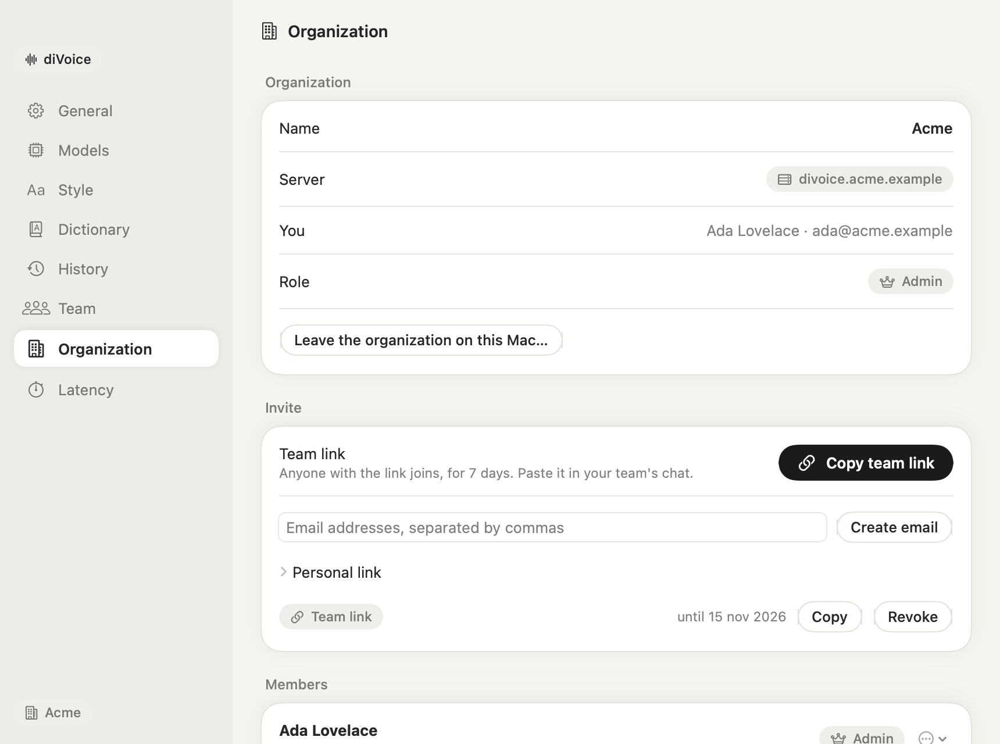
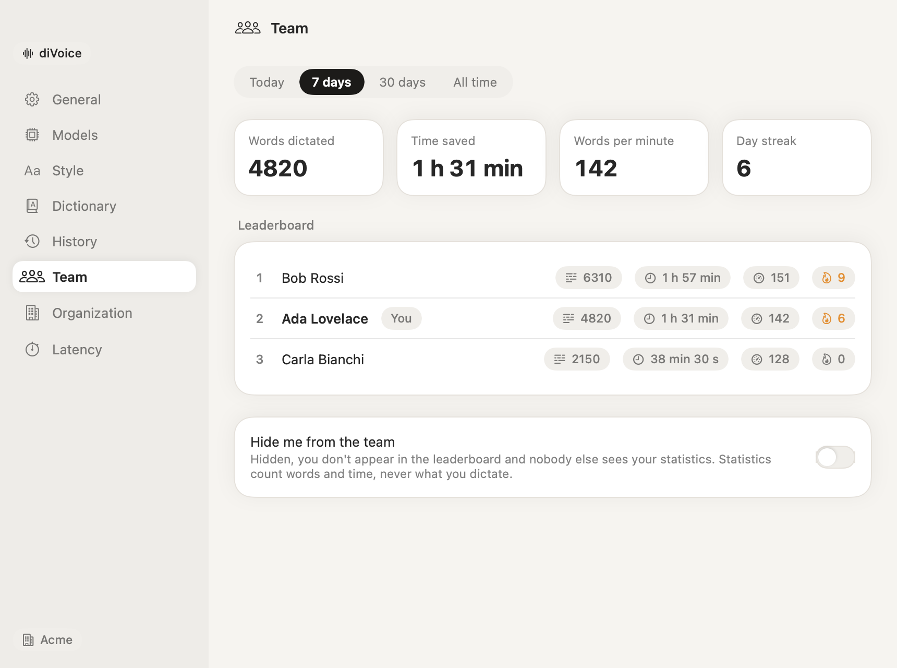

# Organizations

An organization is a team that shares a server, [diServer](https://github.com/tommasoseita/diServer), which also serves diMail. Each organization runs its own server, on its own Cloudflare account: there is no central diVoice service, and no organization's data ever reaches another's.

The server:

- **holds the AI keys** (encrypted) and the **models** the admins choose, for everyone;
- **relays each dictation** to the provider with that key, keeping a copy of the audio only for the length of the dictation;
- **manages members and invites**;
- **keeps the team dictionary**;
- **keeps statistics** made of counts, never text.

To create one, follow [Setting up a team](tutorials/setting-up-a-team.md); for deployment details, [Self-hosting](self-hosting.md).

## Roles

| | Member | Admin |
|---|---|---|
| Dictate with the organization's models | ✓ | ✓ |
| Use the team dictionary | ✓ | ✓ |
| See their own statistics, and the leaderboard if enabled | ✓ | ✓ |
| Hide from the team | ✓ | ✓ |
| Save or remove AI keys | | ✓ |
| Choose the models | | ✓ |
| Invite, promote and remove members | | ✓ |
| Edit the team dictionary | | ✓ |
| Rename the organization, turn the leaderboard on or off | | ✓ |

An organization always keeps at least one admin.

## The admin panel

Admins find it in **Settings › Organization**.

### AI provider keys

Paste a key and click **Save**. It is encrypted on the server (AES-GCM, with a key derived from the server's `SERVER_SECRET`, or `DIVOICE_SECRET` on servers set up before diServer) and never returned by the server, not even to admins. Members never receive it. **Remove** deletes it. A key set as a Worker secret on the server is shown as "Set as a server secret" and used when no key was saved here.

### Models

The same choices as personal mode (see [Providers and models](providers-and-models.md)), applied to everyone. Click **Save models**; members get the change at their next dictation. Then press **Verify** in **Settings › Models** to check each step through the server.

### Invites

| Invite | Who can use it | Valid | How you share it |
|---|---|---|---|
| **Team link** | Anyone with the link | 7 days, any number of people | Copied: paste it in your team's chat |
| **Email** | Only the addresses you type, once each | 7 days | A draft in your mail app, with the link; you send it |
| **Personal link** | One person, name and email filled in | 14 days, once | Copied: send it privately |

Active invites are listed with **Copy** and **Revoke**.

A team link can't be used with the email of an existing member: addresses aren't verified, so this keeps anyone from taking over an account. To reconnect a member on a new Mac, send them a **personal link**; it replaces their old token.

**What the invited person sees:** a page with your organization's name and who invited them, a **Download diVoice** button and an **I already have diVoice** button. The download is served by your server and named after the invite, so diVoice recognizes it at the first launch and offers to join. See [Joining a team](tutorials/joining-a-team.md).

### Members

The list shows each member's name, email and role, and whether they hide from the team. From the ⋯ menu, admins can **make admin** or **make member**, and **remove from the organization**: the member's token stops working within a minute, and their diVoice goes back to personal mode. Their past statistics stay, without their name in the leaderboard.

### Team dictionary

Terms added here apply to every member's dictation, together with their personal dictionary: the company, the products, the clients, the colleagues' names. Use **Heard as** for forms that get misheard. See [Your first dictionary](tutorials/your-first-dictionary.md).

## Statistics and privacy

For each dictation, the app sends the server the number of words, the length of the audio, the member's local day and typing speed, and the app category. **Never the text.** From these the server computes, per member:

- words dictated;
- time saved: typing the same words at the member's speed, minus the speaking time;
- words per minute while speaking;
- the day streak.

**Settings › Team** shows each member their own statistics and, if enabled, the leaderboard for today, 7 days, 30 days or all time.

Two controls decide who sees what:

- **Leaderboard** (admins): when off, nobody sees anyone else's statistics, admins included; the server doesn't return them.
- **Hide me from the team** (each member): a hidden member doesn't appear in the leaderboard and nobody else sees their statistics. Admins still see their name in the member list.

Everyone always sees their own statistics.

## Leaving

A member can leave on a Mac from **Settings › Organization › Leave the organization on this Mac**: diVoice goes back to personal mode, and the account stays until an admin removes it. Coming back takes a new invite.
