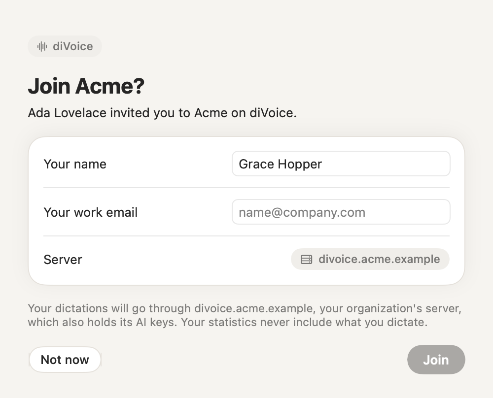
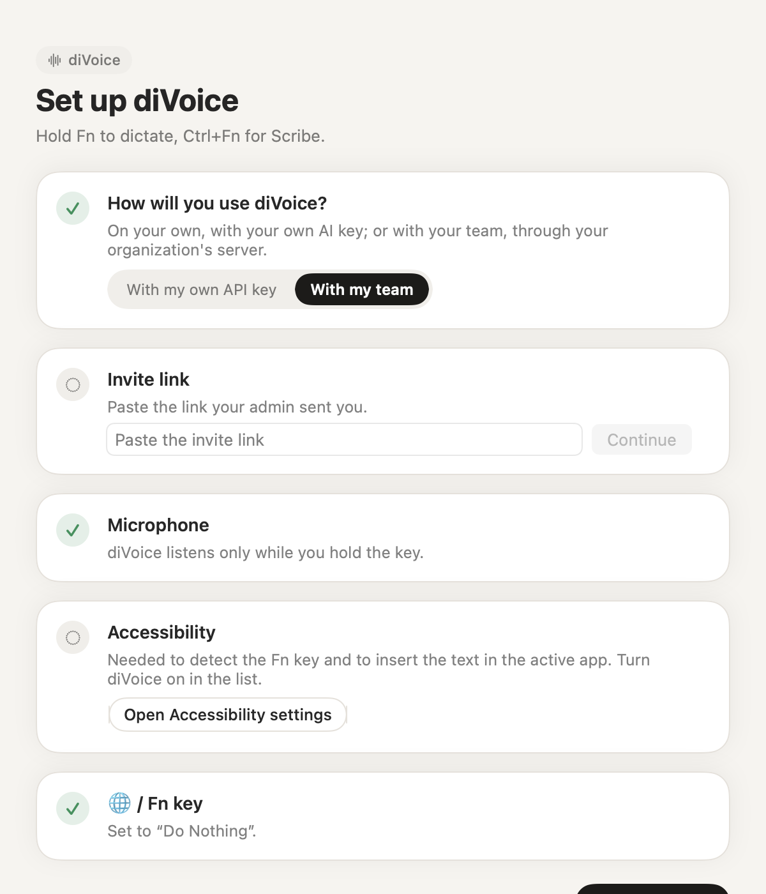
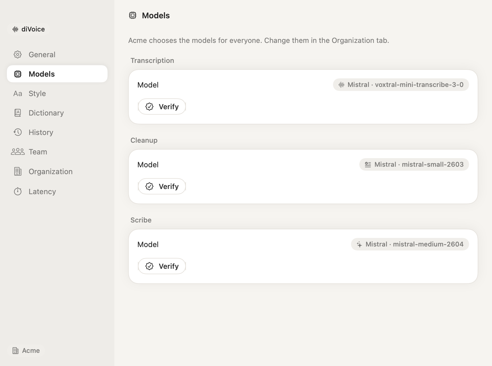
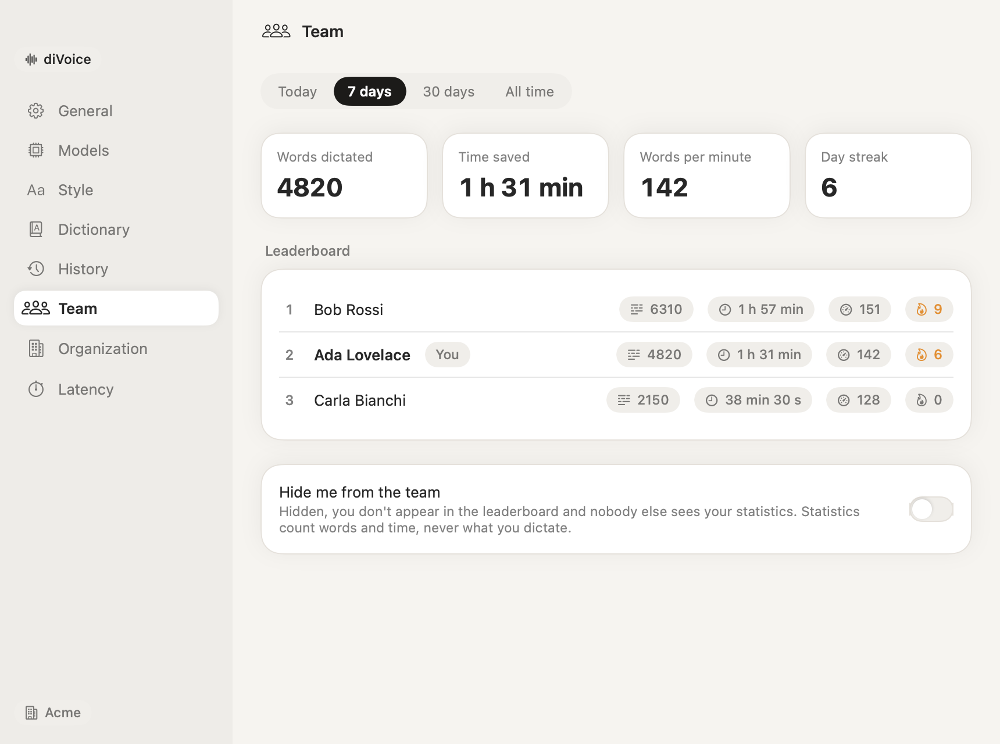

# Tutorial: joining a team

Your organization runs a diVoice server and sent you an invite link. You don't need an AI key or any configuration: the server provides them.

## If you don't have diVoice yet

1. **Click the invite link.** The page says who invited you and to which organization.
2. **Click Download diVoice.** The disk image's name carries your invite, for example `diVoice (Acme) [diserver.acme.workers.dev …].dmg`.
3. **Open the disk image** from your Downloads.
4. **Drag diVoice to Applications and open it**, or double-click it right there in the disk image window. macOS asks for confirmation the first time: choose **Open**.
5. **diVoice recognizes the invite** and asks "Join Acme?". Check your name (and your work email, for a team link) and click **Join**. If you opened it from the disk image, diVoice moves itself to Applications and reopens.
6. **Allow the microphone.**
7. **Allow Accessibility:** click **Open Accessibility settings** and turn diVoice on (Touch ID or your password, once).
8. **Set the 🌐 key** to "Do Nothing" if diVoice asks.
9. **Hold Fn and speak.**

> **diVoice didn't show the invite?** It reads it from the disk image, so it needs the image to still be open at the first launch. If you ejected it first, go back to the invite page and click **I already have diVoice: open it**.

## If you already have diVoice

Click the link, then **I already have diVoice: open it**, confirm that your browser may open diVoice, and click **Join**. That's it.

Or, in the setup window, choose **With my team** and paste the link.

## What changes when you join

- **The models are your organization's.** **Settings › Models** shows them; there are no keys to enter.

  

- **Your dictations go through your organization's server**, which adds the AI key. It doesn't keep what you dictate: only counts (words, minutes) for the statistics.
- **You get the team dictionary** together with your own.
- **Settings › Team** shows your statistics from every Mac you use, and the leaderboard if your admin enabled it. Turn on **Hide me from the team** if you prefer not to appear.

## Leaving, or a new Mac

- **Settings › Organization › Leave the organization on this Mac** takes diVoice back to personal mode. Your account stays until an admin removes it.
- **On a new Mac,** ask your admin for a **personal link**: team links can't reconnect an existing member, so nobody else can take over your account by typing your email.
