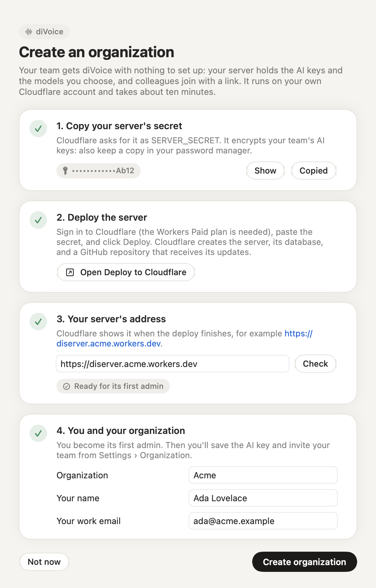
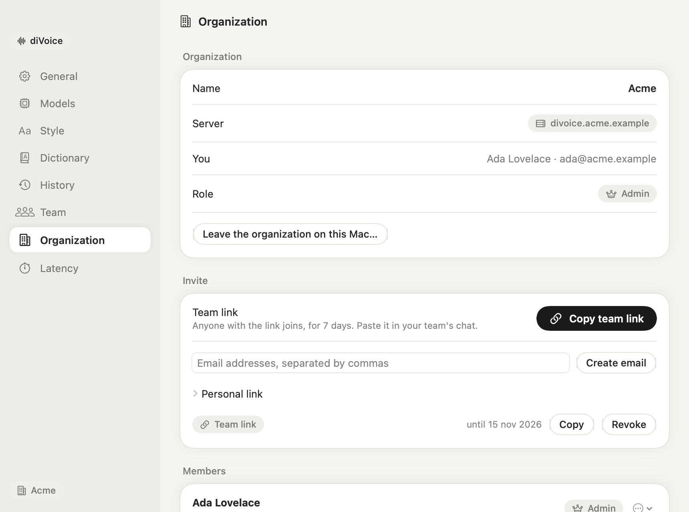

# Tutorial: setting up a team

An organization gives your colleagues diVoice without any setup on their side: your server holds the AI keys and the models you choose, they join with a link, and you share a dictionary and, if you like, a leaderboard.

The server is [diServer](https://github.com/tommasoseita/diServer), running on your own Cloudflare account. diVoice creates it with you in about ten minutes. You need:

- a [Cloudflare](https://dash.cloudflare.com/sign-up) account with the **Workers Paid** plan ($5/month), which diVoice's audio relay needs;
- a [GitHub](https://github.com/signup) account: Cloudflare puts your server's configuration in a repository of yours, where its updates arrive;
- an API key from [Mistral](https://console.mistral.ai/api-keys) (transcription through the server uses Mistral; cleanup and Scribe can also use OpenAI);
- diVoice installed on your Mac.

## 1. Start in diVoice

Open the menu bar icon › **Setup and permissions…**, choose **With my team**, then **Create an organization…**.

## 2. Copy the server's secret

diVoice has generated a secret for your server. Click **Copy**, and also save it in your password manager: it encrypts the AI keys you'll save, and it proves you are the one setting up the first admin. diVoice keeps it until your organization exists.

## 3. Deploy the server

> **Data in the European Union?** The Deploy button doesn't create the database in the EU, and a database's location can't be changed later. If your organization needs its data in the EU, first create the database yourself, following [Step 1](https://github.com/tommasoseita/diServer/blob/main/docs/setup.md#step-1-only-for-organizations-in-europe-create-the-database-in-the-eu) of diServer's guide, then come back here.

Click **Open Deploy to Cloudflare**. On Cloudflare:

1. Sign in. Under **Git account**, click **New GitHub connection**, sign in to GitHub and install the **Cloudflare Workers and Pages** app when GitHub asks; back in the form, pick your account. Tick **Create private Git repository**.
2. **Project name:** `diserver` is fine. It becomes the start of your server's address.
3. **The database:** if you created one in the EU, open **Select D1 database** and choose it; otherwise leave **+ Create new**.
4. Paste the secret into **SERVER_SECRET**, and type your organization's name in **ORG_NAME**. Leave the rest as it is.
5. Click **Deploy**.

Cloudflare creates a repository in your GitHub account with the server's configuration, installs the server, applies the database schema and shows the server's address at the end, for example `https://diserver.acme.workers.dev`. If it first asks you to choose a `workers.dev` subdomain, pick a short name: it becomes part of the address.

A new address can take **up to an hour** to start working; until then Cloudflare shows "error code: 1042". Nothing is wrong with your server: wait, and continue when it answers. diServer's guide has [every field of the form](https://github.com/tommasoseita/diServer/blob/main/docs/setup.md#deploy-with-one-click) in detail.

## 4. Become the first admin

Back in diVoice, paste the address and click **Check**: it should say **Ready for its first admin**. If it says no server answers yet, the new address isn't live: try again in a few minutes. Fill in the organization's name, your name and your work email, then click **Create organization**.

diVoice connects to your server as its admin. From now on your dictations go through it.

> Prefer the command line? diServer's guide covers [deploying by hand](https://github.com/tommasoseita/diServer/blob/main/docs/setup.md#deploy-by-hand) and [claiming the server with curl](https://github.com/tommasoseita/diServer/blob/main/docs/setup.md#divoice-first-admin).

## 5. Add the AI key and check the models

In **Settings › Organization**, under **AI provider keys**, paste your Mistral key and click **Save**. It is encrypted on your server and never shown again, not even to you; members never receive it.

The models section has sensible defaults (the same as personal mode with Mistral). Change them if you like, click **Save models**, then go to **Settings › Models** and press **Verify** for transcription, cleanup and Scribe.

## 6. Invite your colleagues

In **Settings › Organization › Invite**:

- **Copy team link:** anyone with the link can join for 7 days. Paste it in your team's chat.
- **Create email:** type the addresses; diVoice opens a draft in your mail app with a link that only those addresses can use. You review and send it.
- **Personal link:** for one person, with name and email already filled in. It also reconnects a member on a new Mac.

Your colleagues follow [Joining a team](joining-a-team.md): click the link, install, allow two permissions, done.

## 7. Decide about the leaderboard

**Settings › Team** shows each member's words, time saved, speaking speed and streak. If you'd rather not compare people, turn **Leaderboard** off in the admin panel: everyone then sees only their own statistics. Members can also hide themselves. No statistic ever includes what was dictated.

## What's next

- Fill the **team dictionary** with your company's names, products and clients.
- Read the [Organizations guide](../organizations.md) for roles, members and invites in detail, and [Self-hosting](../self-hosting.md) for updates, backups and the API.
- Server updates arrive as pull requests in the repository Cloudflare created for you: merging one deploys it.
