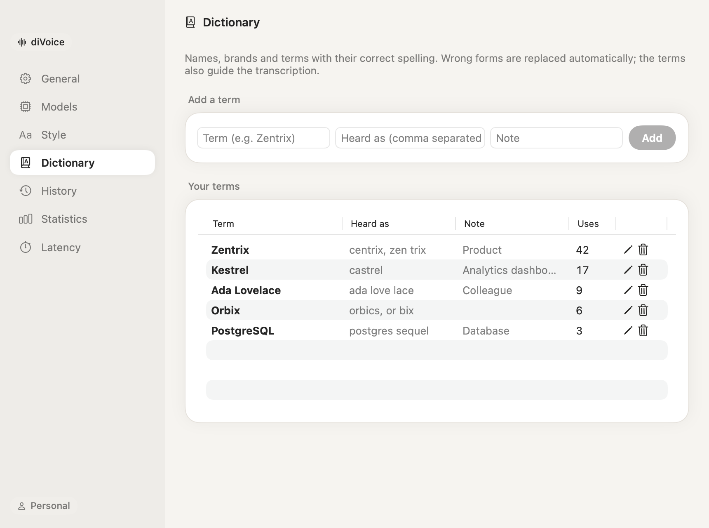

# Tutorial: your first dictionary

Speech recognition knows common words; it can't know your product names, your colleagues' surnames or the acronyms your team uses. Five minutes with the dictionary fixes most of the remaining mistakes.

## 1. Notice what goes wrong

Dictate normally for a day. When a name comes out wrong, note what came out: "Zentrix" written as "Centrix", "Kestrel" as "castrel".

## 2. Add the term

Open **Settings › Dictionary** and fill in the first row:

| Field | Example | What it does |
|---|---|---|
| Term | `Zentrix` | The spelling diVoice will use |
| Heard as | `centrix, zen trix` | Wrong forms, replaced automatically wherever they appear |
| Note | `Product` | Optional context for the AI, useful for terms that are also common words |

Click **Add**.

## 3. Dictate it again

Say a sentence with the term. Two things now help:

- **the recognition is biased** towards your terms, so it is more likely to hear them right in the first place;
- **the wrong forms you listed are replaced** after the transcription, so even a miss comes out right.

The **Uses** column counts how often each term appeared in your dictations: it tells you which entries are earning their place.

## Good entries

- **Proper nouns, brands, products, acronyms, technical terms.** Not common words: those are already right.
- **Capitalization counts:** "PostgreSQL", "iOS", "McKinsey".
- **Add a note for ambiguous terms.** A product called "Discover" is also a common word: a note like "our product, only when talking about it" lets the AI decide from the context.
- **Keep heard-as forms specific.** Only wrong forms that would never be correct, otherwise a real word could be replaced.

## In a team

Your organization can keep a shared dictionary: the admin adds the terms everyone needs (the company, the products, the clients) in **Settings › Organization › Team dictionary**. They apply to every member's dictation together with your own, and appear at the bottom of your Dictionary page.
